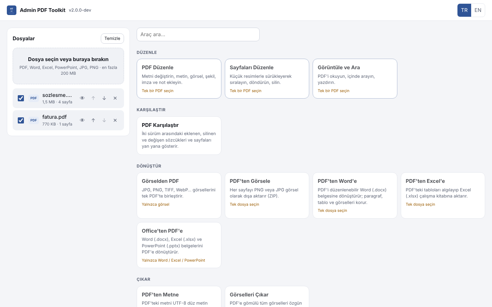
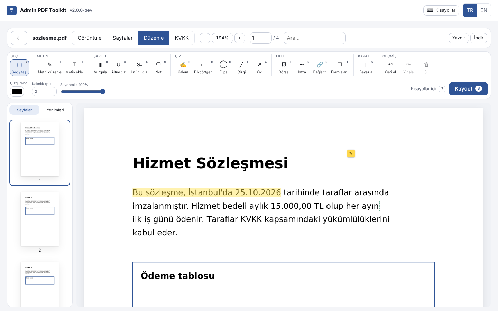
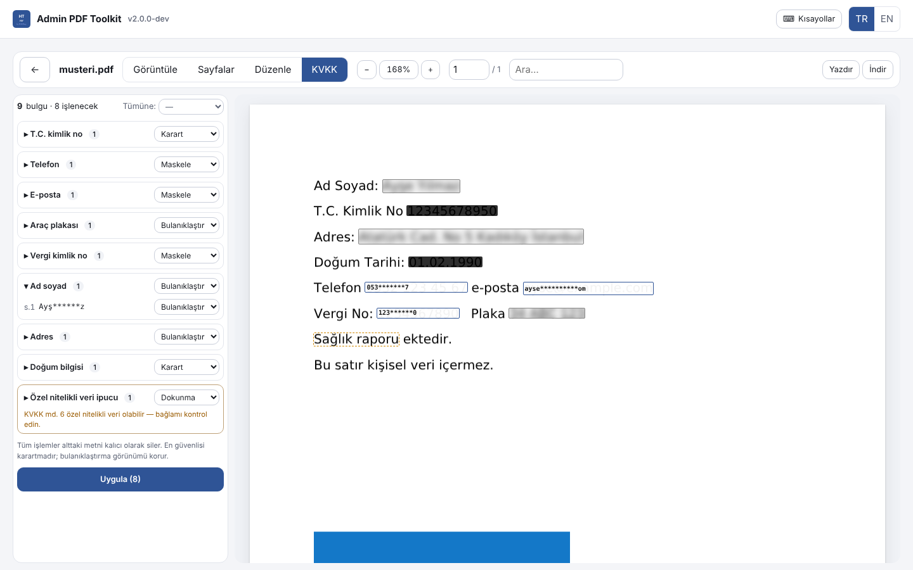
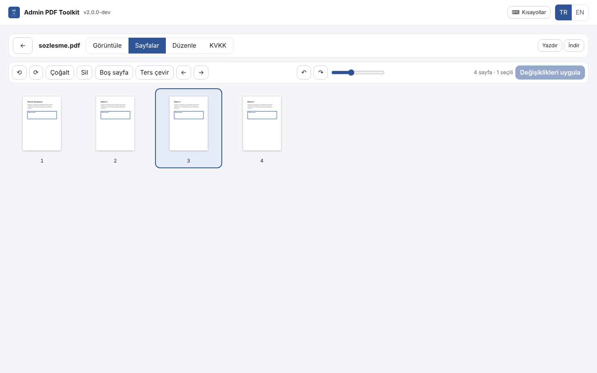
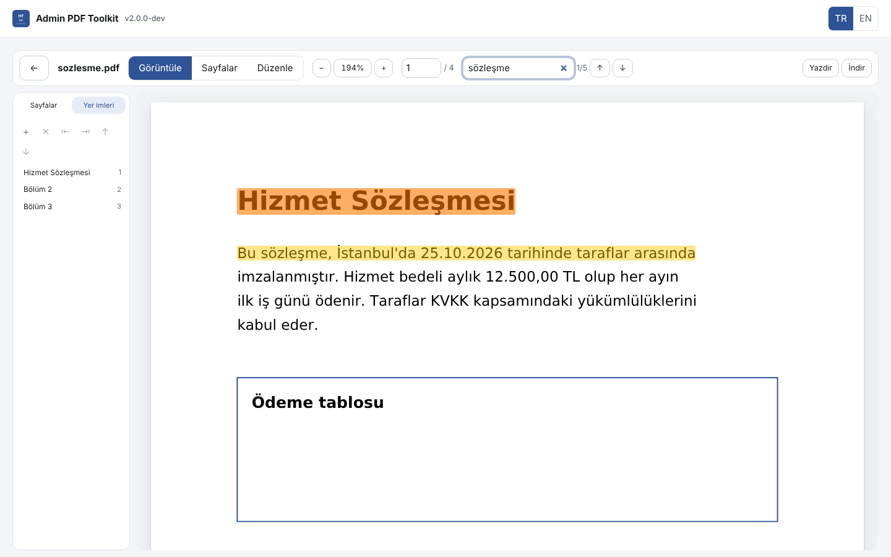
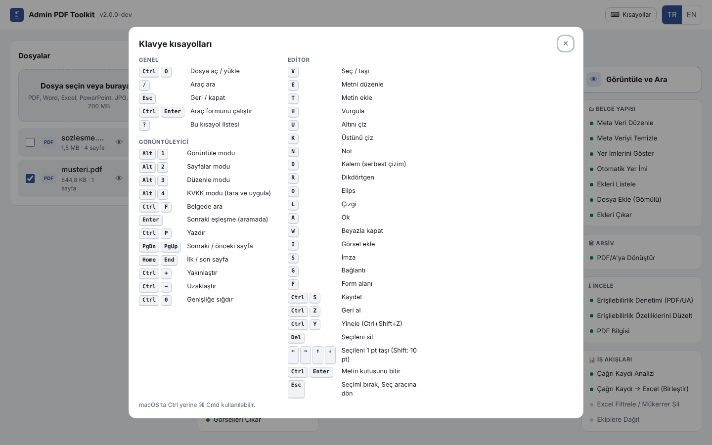

<div align="center">


# Admin PDF Toolkit

**Çevrimdışı, LAN içi, açık kaynak PDF uygulaması — Acrobat seviyesinde düzenleme, KVKK uyumlu**

*PDF düzenle · dönüştür · OCR · dijital imza · formlar · KVKK karartma · PDF/A · karşılaştırma — dosyalar makineden çıkmaz*
*Offline, LAN-first, open-source PDF application — edit, convert, OCR, sign, forms, redact, archive. Files never leave the machine.*

🌐 **TR · EN** — Bu README iki dillidir / This README is bilingual (English collapsibles below each section)

</div>

<div align="center">

[](LICENSE)
[](CHANGELOG.md)
[](https://github.com/AmrasElessar/adminpdftoolkit/actions/workflows/ci.yml)
[](https://github.com/AmrasElessar/adminpdftoolkit/actions/workflows/codeql.yml)
[](https://www.python.org/)
[](https://svelte.dev/)
[](https://pymupdf.readthedocs.io/)
[](STANDARDS.md)
[](STANDARDS.md)
[](#-kvkk--personal-data)
[](#-d-brand-ailesi--d-brand-family)

</div>

## 🎬 Demo

<div align="center">

| | |
|---|---|
|  |  |
| **50+ araç, tek ekranda** — üzerine gelince açıklama | **PDF editörü** — metni değiştir, vurgula, not, imza |
|  |  |
| **KVKK modu** — tara, karart / bulanıklaştır / maskele | **Sayfa düzenleyici** — sürükle-bırak, döndür, sil |
|  |  |
| **Görüntüleyici** — arama, yer imleri, yazdırma | **Klavye kısayolları** — `?` ile her yerde |

</div>

---

## 📌 Kısaca

**Admin PDF Toolkit**, kurum içi ağda çalışan, **internete ihtiyaç duymayan** ve **ücretsiz** bir PDF uygulamasıdır. Bir bilgisayarda sunucu olarak çalışır; aynı ağdaki herkes tarayıcıdan veya telefondan (PWA) kullanır. Yüklenen dosyalar **makineden hiç çıkmaz**, bulut servislerine gönderilmez ve süre sonunda silinir.

Adobe Acrobat'ta beklenen işlerin neredeyse tamamını yapar: **mevcut metni düzenleme** (taranmış belgelerde OCR ile bile), sayfa düzenleme, Word/Excel/PowerPoint ↔ PDF dönüşümü, **OCR**, **PAdES dijital imza**, **form oluşturma ve doldurma**, **KVKK'ya göre kişisel veri tarama ve kalıcı karartma**, **PDF/A**, belge karşılaştırma, sıkıştırma, şifreleme ve daha fazlası.

<details>
<summary>🇬🇧 At a glance (English)</summary>

**Admin PDF Toolkit** is a free PDF application that runs on your own network and **needs no internet**. One computer runs the server; everyone on the LAN uses it from a browser or phone (PWA). Uploaded files **never leave the machine**, are never sent to a cloud service and expire automatically.

It covers almost everything people use Adobe Acrobat for: **editing existing text** (even on scans, via OCR), page organisation, Word/Excel/PowerPoint ↔ PDF, **OCR**, **PAdES digital signatures**, **form creation and filling**, **personal-data scanning and permanent redaction (KVKK/GDPR)**, **PDF/A**, document comparison, compression, encryption and more.

</details>

---

## ✨ Öne Çıkan Özellikler / Highlights

| Grup | Neler var |
|---|---|
| ✎ **PDF editörü** | Mevcut metni yerinde değiştirme (orijinal font eşleştirme, sistem fontları), metin kutusu, görsel, el yazısı / yazılı / görsel imza, şekiller, kalem, beyazla kapatma, bağlantı, vurgulama / altı / üstü çizili, yapışkan not, **form alanı oluşturma**; taşı, boyutlandır, geri al / yinele |
| 🔍 **Taranmış belgeler** | Görsel tabanlı PDF'ler algılanır, tek tıkla **OCR** (Türkçe + İngilizce) uygulanır ve metin düzenlenebilir hale gelir; eğik sayfalar otomatik düzeltilir |
| ⬛ **KVKK modu** | Belge otomatik taranır: T.C. kimlik no, IBAN, kart, telefon, e-posta, plaka, vergi no, ad-soyad, adres, doğum bilgisi ve **özel nitelikli veri** ipuçları; her biri için **karart / bulanıklaştır / maskele / beyazla / dokunma** seçilir, kalıcı uygulanır |
| 📑 **Sayfalar** | Küçük resimlerle sürükle-bırak düzenleme, döndür, sil, çoğalt, boş sayfa; birleştir (yer imli), böl, çıkar |
| 🔄 **Dönüştür** | PDF ↔ Word, PDF → Excel (tablo algılama), Word / Excel / PowerPoint → PDF, PDF ↔ JPG / PNG, PDF → metin |
| 📷 **Görselden PDF** | Telefon fotoğrafı yönü (EXIF), **otomatik eğim düzeltme**, kâğıdı bulup **perspektif düzeltme**, gölge temizleme, siyah-beyaz tarama görünümü |
| ✒ **İmza** | PAdES dijital imza (görünür / görünmez), imza doğrulama, imza sertifikası oluşturma |
| 🧾 **Formlar** | Alanları listele, doldur, düzleştir; editörde metin kutusu, onay kutusu, açılır liste, imza alanı çiz |
| 🏛 **Arşiv & standartlar** | PDF/A-1b/2b/3b, **PDF/UA erişilebilirlik denetimi ve düzeltme**, meta veri, yer imleri (otomatik dahil), gömülü ekler |
| ⚖ **Karşılaştır** | İki sürüm arasında eklenen / silinen sözcükler ve sayfalar, yan yana rapor |
| 🛡 **Güvenlik** | AES-256 şifreleme ve izinler, güvenlik taraması (JavaScript, gömülü dosya, ClamAV), güvenli temizleme, onarım |
| 📊 **İş akışları** | Çağrı kaydı PDF'leri → birleşik Excel, mükerrer silme, filtreleme, ekiplere dağıtım |
| ⌨ **Kullanım** | Tam klavye desteği ve kısayollar (`?`), TR / EN, açık / koyu tema, mobil uyumlu PWA |

<details>
<summary>🇬🇧 Highlights (English)</summary>

- **PDF editor** — change existing text in place (original font matching, system fonts), text boxes, images, drawn / typed / image signatures, shapes, pen, whiteout, links, highlight / underline / strikethrough, sticky notes, **form-field creation**; move, resize, undo / redo.
- **Scanned documents** — image-only PDFs are detected and made editable with one-click **OCR** (Turkish + English); tilted pages are straightened.
- **KVKK mode** — automatic scan for national IDs, IBANs, cards, phones, e-mails, plates, tax numbers, names, addresses, birth details and **special-category** hints; choose **black-out / blur / mask / white-out / keep** per finding and apply permanently.
- **Pages** — drag-and-drop organiser, rotate, delete, duplicate, blank pages; merge (with bookmarks), split, extract.
- **Convert** — PDF ↔ Word, PDF → Excel (table detection), Word / Excel / PowerPoint → PDF, PDF ↔ JPG / PNG, PDF → text.
- **Images → PDF** — EXIF orientation, **automatic deskew**, sheet detection with **perspective correction**, shadow removal, black-and-white scan look.
- **Signatures** — PAdES (visible / invisible), verification, self-signed certificate creation.
- **Forms**, **PDF/A**, **PDF/UA check & fix**, metadata, bookmarks, attachments, **compare**, AES-256, security scan, sanitise, repair, call-log workflows.
- Full keyboard support (`?`), TR / EN, light / dark, installable PWA.

</details>

---

## 🎯 Vizyon / Vision

Kamu kurumları, okullar, sağlık birimleri, hukuk büroları ve şirket BT ekipleri PDF'lerini **dışarıya göndermeden** işlemek zorundadır. Çevrimiçi PDF servisleri KVKK riski taşır, ticari masaüstü yazılımları kullanıcı başına pahalıdır. Admin PDF Toolkit bu boşluğu doldurur: **tek kurulum, tüm ağ, sıfır dış bağımlılık, açık kaynak.**

<details>
<summary>🇬🇧 Vision (English)</summary>

Public bodies, schools, healthcare units, law firms and corporate IT teams must process PDFs **without sending them outside**. Online PDF services are a compliance risk and commercial desktop software is expensive per seat. Admin PDF Toolkit fills the gap: **one install, the whole network, zero external dependencies, open source.**

</details>

---

## 📥 Kurulum / Installation

### Windows (en kolay — kurulum gerektirmez)

1. [Son sürüm](https://github.com/AmrasElessar/adminpdftoolkit/releases/latest) sayfasından **`AdminPDFToolkit-…-Windows.zip`** dosyasını indirin ve bir klasöre çıkarın.
2. **`AdminPDFToolkit.exe`** dosyasına çift tıklayın. Başlatıcı Python'dan başlayarak her bileşeni tek tek denetleyip işaretler (✔ / ⚠ / –), sunucuyu **konsol penceresi açmadan** başlatır, "Sistem hazır" der ve adres, yerel ağ adresleri, sertifika parmak izi, veri klasörü bilgilerini gösterir; tarayıcı açılır. Pencereyi kapatınca uygulama **sistem çubuğunda** çalışmaya devam eder; **Çıkış** ile tamamen kapanır.

Python veya başka bir program kurmanız gerekmez; paket kendi Python'unu, tüm kütüphaneleri, **OCR motorunu (Tesseract + Türkçe/İngilizce dil verisi)** ve **Ghostscript'i (PDF/A)** içerir; internetsiz çalışır — indirmeleri engelleyen kurum ağlarında da. Gömülü araçlar her kullanımdan önce paketteki SHA-256 listesine göre doğrulanır.

**Güncellemeler:** başlatıcı açılışta (isteğe bağlı) yeni sürümü denetler; varsa içerdiği bileşen sürümleriyle birlikte sorar, **kurup kurmamak sizin seçiminiz**. Yalnızca imzası (Ed25519) ve SHA-256 özeti doğrulanan paketler kurulur; verileriniz ve sertifikanız korunur. Ağ güncellemeyi engelliyorsa uygulama normal çalışmaya devam eder.

İlk açılışta Windows, uygulamanın yerel HTTPS sertifikasına güvenmek için bir kez onay ister (sonradan: başlatıcıda **Diğer ▸ Sertifikaya güven**). Konsollu yedek başlatma dosyaları `scripts\` klasöründedir.

### Docker (tüm araçlar dahil: OCR, LibreOffice, Ghostscript, ClamAV)

```bash
git clone https://github.com/AmrasElessar/adminpdftoolkit.git
cd adminpdftoolkit
docker compose up -d --build        # https://localhost:8000 (sertifika: docker cp ile /data/tls/ca.crt)
```

### Kaynaktan / From source

```bash
# sunucu / server (Python 3.11+)
cd server && pip install -e ".[dev]"
# arayüz / web UI (Node 20+) — bir kez derleyin / build once
cd ../web && npm ci && npm run build
# çalıştır / run
cd ../server && python -m adminpdf --open
```

İsteğe bağlı sistem araçları — yoksa ilgili araç açık bir uyarı verir, diğerleri çalışır:
**Tesseract** + `tur` dil paketi (OCR), **LibreOffice** (Office → PDF yüksek doğruluk), **Ghostscript** (PDF/A), **qpdf** (onarım), **ClamAV** (virüs taraması).

> **Windows'ta OCR:** kurulum gerektirmeyen Windows paketinde OCR hazır gelir. Python paketiyle çalıştırıyorsanız **`OCR Kur (Windows).bat`** Tesseract'ı (winget, kurulum dosyası özeti doğrulanarak) ve Türkçe dil paketini kurar. Elle kurmak isterseniz: [UB-Mannheim Tesseract](https://github.com/UB-Mannheim/tesseract/wiki) kurulumunda *Additional language data* altından **Turkish**'i işaretleyin. PATH'e eklemeniz gerekmez; uygulama `Program Files\Tesseract-OCR` ve `Program Files\gs` klasörlerini kendisi bulur. Kurulumdan sonra uygulamayı yeniden başlatın.

<details>
<summary>🇬🇧 Installation (English)</summary>

- **Windows:** download **`AdminPDFToolkit-…-Windows.zip`** from the [latest release](https://github.com/AmrasElessar/adminpdftoolkit/releases/latest), unzip, double-click **`AdminPDFToolkit.exe`**. The launcher ticks off every component (Python, libraries, UI, certificate, OCR, Ghostscript, …), starts the server with no console window, says "System ready" and shows the addresses and certificate fingerprint; closing the window keeps it in the notification area. Nothing to install — Python, all libraries, Tesseract (+ Turkish/English) and Ghostscript are inside; works offline, also on networks that block downloads. Optional update check at start: a newer release is offered with its component versions and installed only if you agree and its Ed25519 signature and SHA-256 verify. Console fallbacks are in `scripts\`.
- **Docker:** `docker compose up -d --build` — includes OCR, LibreOffice, Ghostscript and ClamAV.
- **From source:** `pip install -e ".[dev]"` in `server/`, `npm ci && npm run build` in `web/`, then `python -m adminpdf --open`.
- Optional tools: Tesseract (+`tur`), LibreOffice, Ghostscript, qpdf, ClamAV. Missing tools only disable their own features.
- OCR on Windows: bundled in the self-contained package. With the Python package, **`OCR Kur (Windows).bat`** installs Tesseract (winget, installer hash checked) and the Turkish data. Manually: install [UB-Mannheim Tesseract](https://github.com/UB-Mannheim/tesseract/wiki) and tick **Turkish** under *Additional language data*. No PATH change needed — the default install folders of Tesseract and Ghostscript are detected. Restart the app afterwards.

</details>

---

## 🚀 İlk Adımlar / Quick Start

1. Dosyaları sol panele **sürükleyin** (PDF, Word, Excel, PowerPoint, JPG, PNG…).
2. Bir PDF seçip **PDF Düzenle**, **Sayfaları Düzenle**, **KVKK Tara ve Karart** veya listeden bir araç seçin.
3. Sonucu indirin ya da **Çalışma alanına ekle** ile bir sonraki araca girdi yapın (ör. birleştir → sıkıştır → şifrele).
4. `?` tuşu tüm klavye kısayollarını gösterir.

**Telefondan / tabletten erişim:** `python -m adminpdf --lan` (Windows: `Baslat - Ag Paylasimi (Windows).bat`) — sunucu bilgisayarında sağ üstteki **📱 Cihaz bağla** penceresindeki QR kodu telefonla okutun. Bağlantı her zaman **HTTPS**'tir; uyarısız kullanım için eşleştirme ekranındaki **Sertifikayı yükle** ile sunucunun sertifikasını cihaza bir kez yükleyin. **Yalnızca aynı yerel ağdaki** (özel IP) cihazlar bağlanabilir; internetten gelen her istek reddedilir.

*Phones/tablets: start with `--lan`, scan the QR code under **📱 Connect device** on the server PC. Always HTTPS (the server's own local CA; install it once via **Install certificate** for warning-free use). Only devices on the same local network are ever served.*

### Ayarlar / Configuration (`APT_*`)

| Değişken | Varsayılan | Açıklama |
|---|---|---|
| `APT_HOST` / `APT_PORT` | `127.0.0.1` / `8000` | Dinlenen adres |
| `APT_DATA_DIR` | `_data` | Yüklemeler ve iş klasörleri |
| `APT_MAX_UPLOAD_MB` | `200` | Dosya başına sınır |
| `APT_FILE_TTL_MINUTES` | `120` | Dosyalar bu süre sonunda silinir |
| `APT_MAX_WORKERS` | `2` | Eşzamanlı iş sayısı |
| `APT_JOB_TIMEOUT_SECONDS` | `600` | İş başına zaman sınırı |
| `APT_WORKER_MEMORY_MB` | `4096` | İş süreci bellek tavanı (POSIX) |
| `APT_LAN_ENABLED` / `APT_PAIRING_KEY` | kapalı | Ağdaki cihazlar eşleştirme anahtarıyla bağlanır (anahtar en az 12 karakter; `--lan` rastgele üretir) |
| `APT_TRUSTED_NETWORKS` | — | Eşleştirme istemeyen **yerel** ağlar (CIDR) veya `gateway` (Docker ana makinesi; LAN modunda yok sayılır) |
| `APT_ALLOWED_HOSTS` | — | Ek Host adları (ör. `pdf.kurum.local`); sertifikaya da eklenir |
| `APT_TLS` | `true` | HTTPS (kendi yerel CA'sı, `APT_DATA_DIR/tls`). Yalnızca kendi TLS vekil sunucunuzun arkasında kapatın |
| `APT_TLS_CERT_FILE` / `APT_TLS_KEY_FILE` | — | Kurumunuzun kendi sertifikası |
| `APT_MAX_STORAGE_MB` | `10240` | Toplam depolama tavanı (aşılırsa yükleme 507) |
| `APT_API_DOCS` | `false` | `/api/docs` geliştirici belgeleri |

---

## ⬛ KVKK / Personal data

- Dosyalar **yalnızca sunucu bilgisayarında** işlenir; hiçbir bulut servisine gönderilmez, analitik/telemetri yoktur.
- Yüklemeler ve sonuçlar **süre sonunda kendiliğinden silinir** (`APT_FILE_TTL_MINUTES`).
- **KVKK modu** kişisel verileri bulur; uygulanan her işlem alttaki metni **kalıcı olarak siler** (bulanıklaştırma yalnızca görünümü korur), meta veriyi temizler.
- Özel nitelikli veri (KVKK md. 6) ipuçları otomatik işlenmez, **insan kararına** sunulur.

<details>
<summary>🇬🇧 Personal data (English)</summary>

Files are processed only on the server machine — no cloud, no telemetry; uploads expire automatically. KVKK mode finds personal data and every treatment permanently removes the underlying text (blur only keeps the look) and strips metadata. Special-category hints (KVKK art. 6) are left for a human decision.

</details>

---

## 🛠️ Teknoloji / Tech Stack

| Katman | Teknoloji |
|---|---|
| Sunucu | Python 3.11+ · FastAPI · PyMuPDF · pikepdf · pyHanko · OCRmyPDF/Tesseract · pdf2docx · OpenCV · LibreOffice (isteğe bağlı) |
| Arayüz | Svelte 5 · TypeScript · Vite · pdf.js |
| Mimari | İşlem kayıt defteri (her araç tek sınıf, form şemadan üretilir) · her iş ayrı süreçte (zaman aşımı, iptal, bellek sınırı) · güvenlik tek ara katmanda (Host izin listesi, CSRF, sıkı CSP, LAN eşleştirme) |
| Kalite | 290+ sunucu testi · mypy --strict · ruff · svelte-check · axe-core WCAG 2.1 AA denetimi · CodeQL · Windows/macOS/Linux CI |

Ayrıntılar: [ARCHITECTURE.md](ARCHITECTURE.md) · Standartlar: [STANDARDS.md](STANDARDS.md)

---

## 📐 Standartlar / Standards

ISO 32000 (PDF) · ISO 19005 (PDF/A) · ISO 14289 (PDF/UA denetim + düzeltme) · ETSI EN 319 142 (PAdES) · ISO/IEC 40500 / WCAG 2.1 AA (arayüz) · ISO 8601 · BCP 47 · KVKK / GDPR — ayrıntılar ve sınırlar [STANDARDS.md](STANDARDS.md) içinde.

---

## 🗺️ Yol Haritası / Roadmap

- [x] v2 mimarisi, güvenlik ara katmanı, süreç izole iş motoru
- [x] Görüntüleyici, sayfa düzenleyici, PDF editörü (taranmış belgeler dahil)
- [x] Dönüştürme, OCR, formlar, dijital imza, KVKK modu, PDF/A, PDF/UA, karşılaştırma
- [x] Docker, CI, PWA, klavye kısayolları, erişilebilirlik
- [ ] Windows kurulum paketi (installer) ve imzalı sürümler
- [ ] PAdES zaman damgası (kurum içi TSA desteğiyle)
- [ ] Etiketsiz belgeler için yarı otomatik PDF/UA etiketleme

v1 (1.13.2) kaynak kodu [`archive/`](archive/) klasöründe ve git geçmişindedir.

---

## 🤝 Katkı / Contributing

Katkılar memnuniyetle karşılanır — [CONTRIBUTING.md](CONTRIBUTING.md). Güvenlik açıkları için lütfen [SECURITY.md](SECURITY.md).

---

## 🎨 D Brand Ailesi / D Brand Family

Admin PDF Toolkit, **D Brand** açık kaynak araç ailesinin bir parçasıdır.

---

## ❤️ Destekle / Support

Proje işinize yaradıysa ⭐ vererek veya [sponsor olarak](https://github.com/sponsors/AmrasElessar) destekleyebilirsiniz.

---

## 📜 Lisans / License

[GNU AGPL-3.0](LICENSE) — bu yazılımı değiştirip **ağ üzerinden hizmet olarak** sunarsanız, değiştirilmiş kaynak kodu kullanıcılarla paylaşmanız gerekir. Üçüncü taraf lisansları: [THIRD_PARTY_LICENSES.md](THIRD_PARTY_LICENSES.md).

<details>
<summary>🇬🇧 License (English)</summary>

GNU AGPL-3.0 — if you modify this software and offer it **as a network service**, you must share the modified source with its users. Third-party licences: [THIRD_PARTY_LICENSES.md](THIRD_PARTY_LICENSES.md).

</details>
